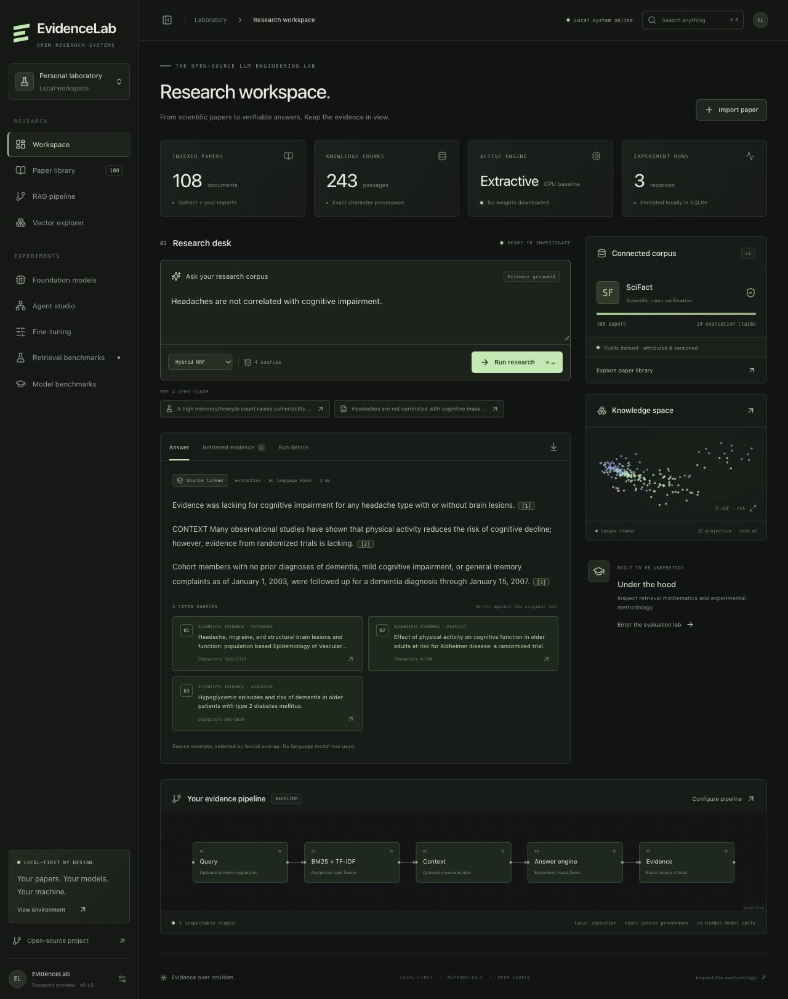
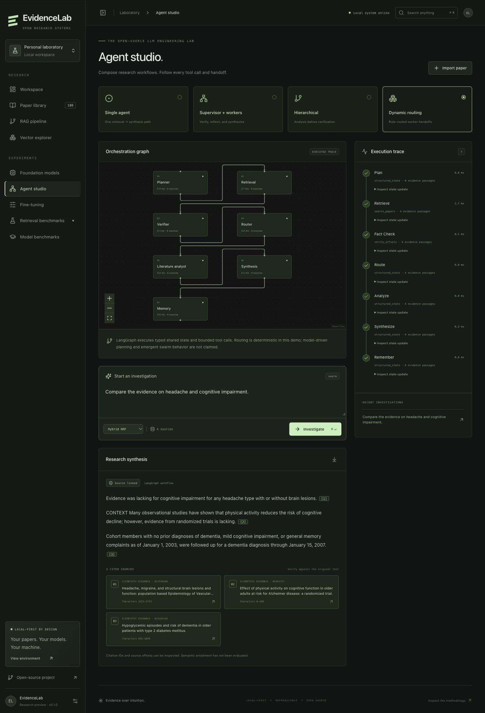
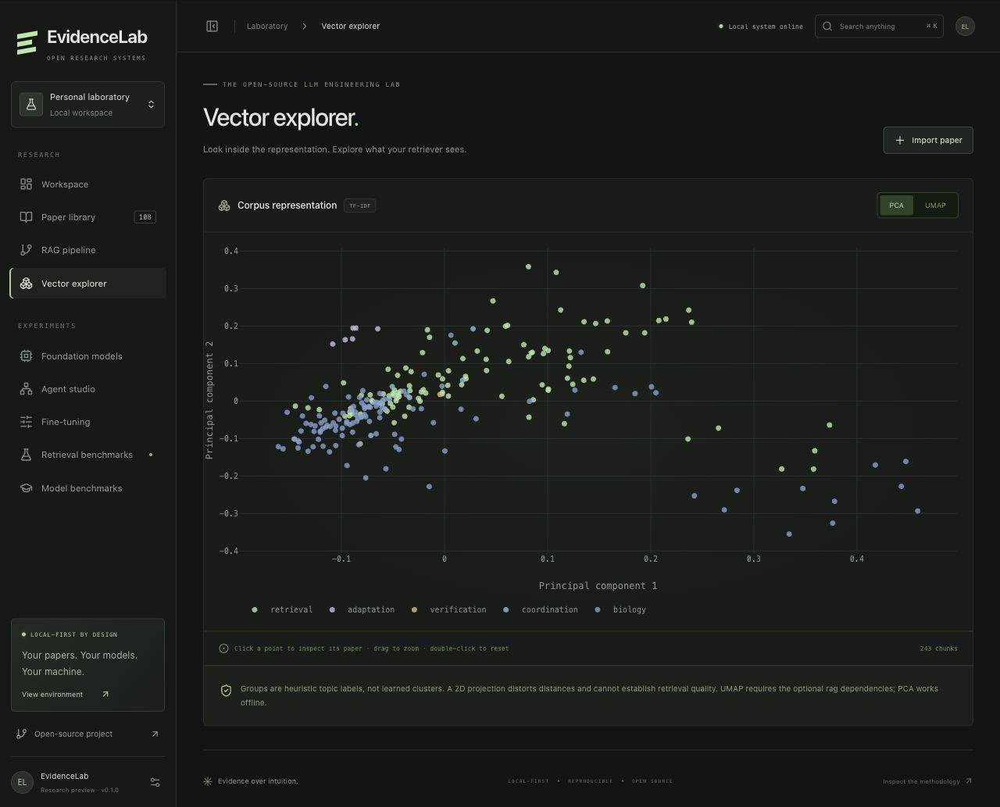
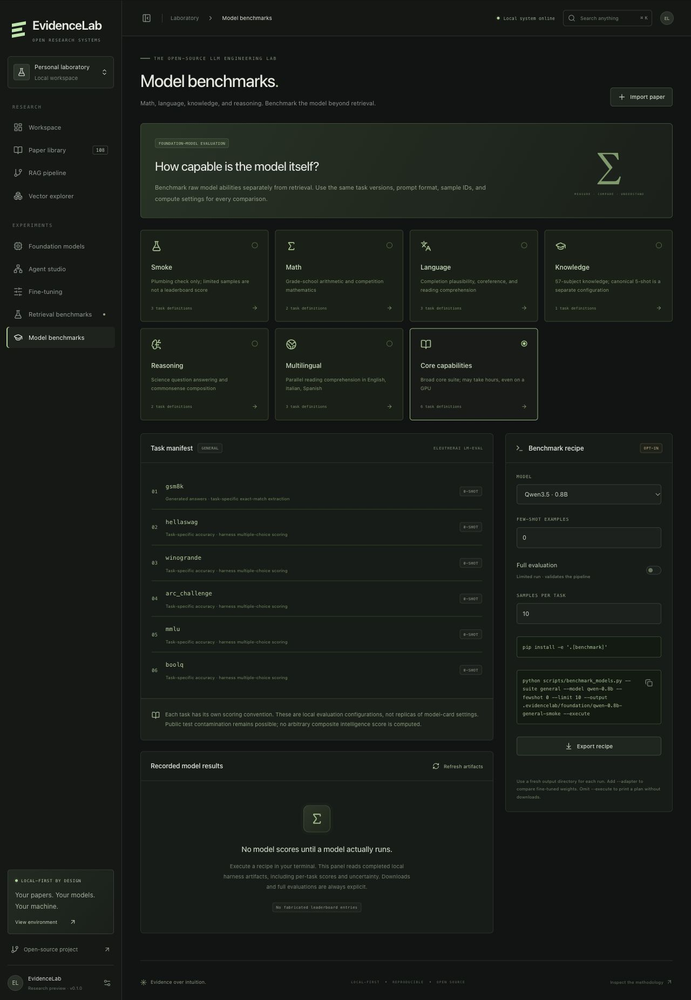
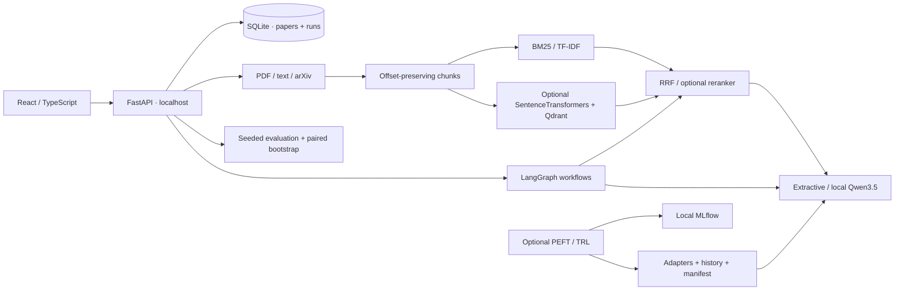

# EvidenceLab

**The open-source LLM engineering lab.** Inspect the evidence. Change the system. Measure the difference.

A local-first research workstation for paper ingestion, cited research answers, retrieval experiments, agent orchestration, and reproducible evaluation. Includes an offline SciFact demo, a FastAPI service, a React control center, mathematical notebooks, and optional Qwen3.5 / PEFT / TRL workflows. No paid APIs or mandatory API keys.

> Research software, v0.1.0. The default answer engine extracts source sentences; it is not an LLM. Neural models and training require optional dependencies and downloads. No model quality or training results are invented. [Verification report](docs/verification.md).

## Quick start · Python 3.12–3.14, Node 22+

```bash
python3.12 -m venv .venv
source .venv/bin/activate
pip install -e '.[dev]'
python scripts/seed.py
cd web && npm ci && cd ..
./scripts/dev.sh
```

Open http://localhost:5173. API docs: http://127.0.0.1:8000/docs. The demo runs on CPU, needs no credentials, and makes no external requests after installation. `scripts/dev.sh` starts both processes and stops them together on Ctrl-C.

```bash
evidencelab ask "All hematopoietic stem cells segregate their chromosomes randomly."
evidencelab benchmark --k 3
pytest
cd web && npm test && npm run build
```

The wheel includes offline demo data; the dashboard and development scripts run from the checkout root. Set `EVIDENCELAB_DATA` to relocate dataset files and `EVIDENCELAB_HOME` for SQLite, run exports, and training artifacts.

For a locked installation, use `uv sync --locked --extra dev` and `source .venv/bin/activate`. The Python lock includes optional extras; only requested extras are installed. The dashboard uses `npm ci` with its committed lockfile.

If default ports are busy: `EVIDENCELAB_WEB_PORT=5199 EVIDENCELAB_API_PORT=8199 ./scripts/dev.sh`.

## Broad model capabilities

The **Model benchmarks** panel adds math (GSM8K/MATH), language (HellaSwag/WinoGrande/BoolQ), knowledge (MMLU), reasoning (ARC/OpenBookQA), and multilingual reading comprehension (Belebele English/Italian/Spanish) through the pinned EleutherAI harness.

```bash
pip install -e '.[benchmark]'
# Plan only; no weights or datasets downloaded:
python scripts/benchmark_models.py --suite general --model qwen-0.8b
# Explicit 10-sample plumbing check:
python scripts/benchmark_models.py --suite smoke --model qwen-0.8b --execute
# Full math suite, recorded separately from RAG results:
python scripts/benchmark_models.py --suite math --model qwen-4b \
  --output .evidencelab/foundation/4b-math --execute
```

Use `--adapter PATH` for adapted-model comparisons, `--revision COMMIT_SHA` for immutable weights, and fresh output directories. Limited runs are labeled as smoke checks. No Qwen capability scores have been prepopulated. See [training and benchmark guide](docs/training.md) and [the executed CPU retrieval report](docs/demo-results.md).

## Executable stages

| Stage | Implemented | Execution / limits |
|---|---|---|
| 01 Baseline | PDF/text/arXiv ingestion; sentence boundaries and offsets; BM25, TF-IDF, cited extractive answers; SQLite persistence | Default CPU demo, 24 real SciFact dev claims and linked corpus plus distractors |
| 02 Advanced RAG | RRF fusion, acronym expansion, optional semantic splitting, SentenceTransformers + embedded Qdrant, cross-encoder reranking, UMAP, concept graph expansion | `pip install -e '.[rag]'`; `EVIDENCELAB_DENSE=1 ./scripts/dev.sh`. Default fusion is **BM25 + TF-IDF**, not neural dense retrieval. Graph expansion is a heuristic, not a reproduction of Microsoft GraphRAG. |
| 03 Adaptation | Deterministic paper-grouped dataset splits, LoRA/QLoRA SFT, adapter export/load, JSON training history, optional local MLflow; DPO/GRPO recipes | `pip install -e '.[train]'`; see [training](docs/training.md). GPU training is opt-in, not executed in the smoke demo. |
| 04 Agents | LangGraph typed shared state, bounded reflection, research tools, checkpoints, persisted traces | UI Agent studio or `evidencelab investigate "…" --architecture supervisor` |
| 05 Coordination | Single, supervisor, hierarchical and rule-routed swarm workflows, handoff graphs | Deterministic orchestration scaffold; Qwen can synthesize with the same evidence interface. No emergent-swarm claim. |
| 06 Evaluation | Recall@k, MRR@k, binary nDCG@k, bootstrap CIs, paired deltas, per-query latency, RSS, dataset/config fingerprints, ablations | UI Evaluation lab or CLI; agent and model suites use the same runner, generated answers retained for independent review |

## Control center

A warm graphite workspace with instrument-style graphs, evidence drawers, configurable pipelines, a vector explorer, model cards, training artifact plots, and measured leaderboard entries. Charts display actual corpus projections and recorded runs. Training charts remain empty until real artifacts exist.



<details>
<summary>More workstation views</summary>





</details>

## Architecture



The CPU baseline has no PyTorch dependency. Qdrant runs embedded in memory as a rebuildable index; SQLite stores original paper text. Model inference is selected at process startup, not by a web endpoint that can trigger arbitrary downloads. The browser only calls the local service. Binding to `127.0.0.1` is intentional; this development workstation is not an authenticated multi-tenant service.

## Models and hardware

Default foundation-model configuration: `Qwen/Qwen3.5-4B`; lightweight profile: `Qwen/Qwen3.5-0.8B`. Both official cards identify Apache-2.0 weights. Model calls use the native `Qwen3_5ForCausalLM` text path with no remote code. These are multimodal checkpoints; EvidenceLab currently supports text only.

```bash
pip install -e '.[models]'
evidencelab hardware --probe
EVIDENCELAB_MODEL=qwen-0.8b ./scripts/dev.sh
# CUDA NF4 only (install the qlora extra first):
EVIDENCELAB_MODEL=qwen-4b EVIDENCELAB_QUANTIZATION=nf4 ./scripts/dev.sh
# Use an exported adapter:
EVIDENCELAB_MODEL=qwen-0.8b EVIDENCELAB_ADAPTER=artifacts/sft/adapter ./scripts/dev.sh
```

MPS uses fp16 and unquantized adapters; CUDA supports NF4 through bitsandbytes. CPU inference is possible but slow and memory intensive. Configuration advice is heuristic, not a fit guarantee. `configs/` contains explicit experiment profiles. Pin immutable model revisions before a publishable experiment; `main` is a convenience default and the resolved commit is recorded by training.

## Scientific contract

- Demo scores measure **document retrieval on a small, selected SciFact dev subset**, not held-out scientific understanding. No tuning conclusions should be drawn from them.
- Zero-overlap lexical queries abstain. Excerpts include paper IDs, chunk IDs, exact character ranges and source links. A valid citation is not proof of entailment.
- Accuracy, faithfulness, hallucination rate and task success are **null until annotated**. Evidence citation integrity and exact/F1 answer matching are separately named proxies. No LLM-as-judge claims without a validated judge.
- Compare systems on identical query IDs. Use paired bootstrap deltas; log ablations, seed, corpus hash, configuration and environment. Report uncertainty and inspect failures.
- Fine-tuning respects document groups and upstream train/dev/test separation. The packaged dev claims are never offered as SFT training data.

Read [experimental methodology](docs/methodology.md), [research references](docs/references.md), [architecture decisions](docs/architecture.md), [data provenance](data/README.md), [limitations](docs/limitations.md), and [training](docs/training.md).

## Learning notebooks

`notebooks/01_retrieval.ipynb`: BM25, TF-IDF, RRF and rank metrics. `02_adaptation.ipynb`: LoRA parameter counts, NF4 intuition, DPO and GRPO equations. `03_experimental_design.ipynb`: paired bootstrap, ablation pitfalls and sample sizes. No notebook downloads a model or starts training.

## Development and deployment

```bash
pip install -e '.[dev]'
ruff check src tests scripts
pytest
cd web && npm ci && npm test && npm run build
# Optional local containers; no model weights in images:
docker compose up --build
```

Docker serves the dashboard and API together at http://localhost:8000. MLflow is optional: `mlflow ui --backend-store-uri sqlite:///mlflow.db`. See [CONTRIBUTING.md](CONTRIBUTING.md), [AGENTS.md](AGENTS.md) and [SECURITY.md](SECURITY.md). Code: Apache-2.0. Data licenses are separate; see [NOTICE](NOTICE).
