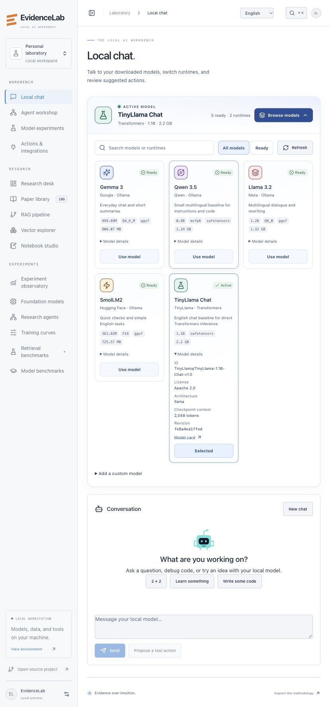
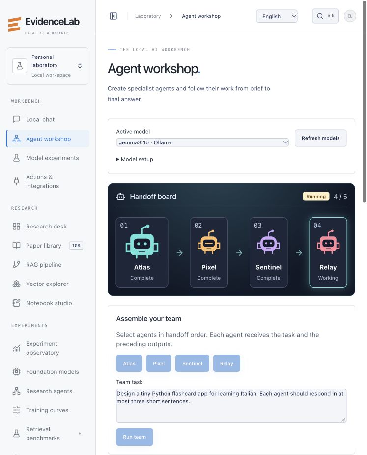

# EvidenceLab workbench

EvidenceLab opens on **Local chat**. The former paper-grounded workspace is now **Research desk**. Use the top bar for English, Italian, or Spanish. The workbench, navigation and model reply-language prompt follow that setting. Existing research internals, bundled notebooks, third-party responses and server diagnostics retain their authored language.

## Models

Start the local runtime separately, download a model, then choose **Browse models → Refresh** in EvidenceLab.

```sh
# In one terminal, with Ollama installed:
OLLAMA_NO_CLOUD=1 ollama serve
# In a second:
ollama pull gemma3:1b
# From this checkout, with the project environment installed:
./scripts/dev.sh
```

Open **Browse models** to filter the local library, inspect a model’s license and checkpoint details, or switch the active model. The library gets download size, format, quantization and revision for installed Ollama tags from [/api/tags](https://docs.ollama.com/api/tags). Models in the catalog that still need weights show the download command. Ollama serves text chat through [/api/chat](https://docs.ollama.com/api/chat).



For a compact starter set, pull the four Ollama variants below and optionally cache TinyLlama for direct Transformers inference. These choices let you compare model families and runtimes on the same task. They are not a ranking.

```sh
ollama pull gemma3:1b
ollama pull qwen3.5:0.8b
ollama pull llama3.2:1b
ollama pull smollm2:360m
pip install -e '.[models]'
hf download TinyLlama/TinyLlama-1.1B-Chat-v1.0
```

Refresh the library after downloading. EvidenceLab automatically checks the cache for supported TinyLlama and Qwen snapshots with local safetensors and tokenizer files. Model card capabilities and the checkpoint context may exceed the limits of this text chat interface and your runtime settings. Keep Ollama cloud disabled for offline inference.

The compatible provider discovers models at a loopback OpenAI-style endpoint. Set the following before starting EvidenceLab if your local [LM Studio](https://lmstudio.ai/docs/developer/openai-compat), llama.cpp or vLLM server uses another port.

```sh
export EVIDENCELAB_COMPATIBLE_URL=http://127.0.0.1:1234/v1
export EVIDENCELAB_OLLAMA_URL=http://127.0.0.1:11434
```

For other [Hugging Face chat checkpoints](https://huggingface.co/docs/transformers/main/en/chat_templating), install the models extra, download weights explicitly, and enter the cached Hub ID or absolute snapshot folder under **Browse models → Add a custom model**. Generic loading requires Transformers support for the architecture, a chat template, and safetensors. It runs offline with remote code disabled. Serve GGUF through Ollama or a compatible runtime. The native Qwen loader remains available for its supported checkpoints. Only one Transformers model is held in the workbench cache at a time. The Research Desk engine is configured separately.

## Agent workshop

Atlas plans, Pixel develops a solution, Sentinel reviews it, and Relay synthesizes the output. Create a named agent with its own instructions, then select agents in execution order. The active node and individual timing are updated from real calls. Each call receives the original task and the preceding handoffs. Current teams use the selected model for every role and run sequentially. This is useful for seeing where a plan improved or failed. Agents return text to the operator. Use the separate action review flow to grant external access.



## Datasets, fine-tuning and repeated evaluation

Add the small demo dataset to check the flow, or upload UTF-8 JSON Lines (maximum 1 MB). Each row uses this shape.

```json
{"split":"validation","prompt":"Return only the number. What is 2 plus 2?","completion":"4","group":"arithmetic-example-1"}
```

Allowed splits are train, validation and test. Supply your own splits. Prompts are checked for normalized duplicates, and shared group identifiers cannot cross splits. Assign groups for related examples, source documents or other dependencies. These checks cannot detect paraphrases or prove upstream provenance. Dataset IDs hash the uploaded bytes. Split hashes are recorded and verified before use. Use validation while iterating and reserve test for the final comparison.

Run an evaluation, then switch the selected model to a second checkpoint or trained adapter and rerun with the same dataset version, split, limit, and label configuration. The panel displays normalized exact match, mean latency, and (for typed decisions with probabilities) multiclass Brier score. Run exports contain per-example results and a Wilson interval. The limit takes the first N examples in the split, so small runs are for checking the workflow. The toy dataset and exact match metric do not measure open-ended answer quality. Standard public benchmarks remain available under **Model benchmarks**.

For browser-launched LoRA install the training extra and explicitly download the desired Qwen3.5 checkpoint to the Transformers cache. Start with Qwen3.5 0.8B, unquantized LoRA, and a small step limit. NF4 requires NVIDIA CUDA and the qlora extra. The browser job calls the existing PEFT/TRL script with the Hub in offline mode. **Training curves** reads real optimizer history from disk. Completed adapters become selectable for chat and repeat evaluations. The browser trainer supports the two Qwen checkpoints listed in its menu. Training other architectures requires a separately verified recipe. The browser launcher requires a checkout and currently runs one team, evaluation or training job at a time per API process.

### Jev and System One

[TypeSafe Jev](https://docs.typesafe.ai/introduction) is a hosted typed decision model. The workbench implements [Choice](https://docs.typesafe.ai/primitives/choice), which returns an option and its distribution. Set EVIDENCELAB_TYPESAFE_API_KEY in the server environment. Select Jev in **Evaluate a model**, enter the model ID or pinned version, provide a JSON label-to-description map, and explicitly consent to sending the selected inputs and instructions to TypeSafe for that run. The provider may charge for usage. Expected answers must match the label IDs. Never upload or evaluate material externally without permission to share it.

Alternatively point EVIDENCELAB_SYSTEMONE_URL to a loopback server exposing the same POST /systemone contract (default http://127.0.0.1:8090/v1). Select **System One · local endpoint** and enter its model ID. A local chat model can use the same labels and instructions to compare classifications. Exact match is comparable across these runs on the same split and limit. Brier score is reported only when the backend returns probabilities.

## Approval inbox and integrations

Open **Actions & integrations** to request a tool directly, or click **Propose a tool action** in chat. A proposal is stored separately from the model response. Review the action, exact input, and destination, then approve once or deny. Requests expire after 15 minutes. The server atomically claims an approval before execution to prevent replays. An interrupted send may have reached the provider. Check the provider before creating a fresh request.

| Action | Setup and behavior |
| --- | --- |
| Wikipedia search and read | Built in. Approval sends the search term or article title to the selected Wikipedia edition. Results are text, and can be attached to a chat turn. |
| Web search | Set EVIDENCELAB_SEARXNG_URL to a loopback [SearXNG](https://docs.searxng.org/dev/search_api.html) service with JSON enabled. The configured engines receive the approved query. |
| Open browser | Set EVIDENCELAB_DESKTOP_ACTIONS=1 to hand an approved HTTPS URL to the server machine’s default browser. |
| Read shared file | Set EVIDENCELAB_SHARED_FILES to a dedicated directory. Reads a bounded regular UTF-8 text file directly inside that directory. |
| Telegram | Set EVIDENCELAB_TELEGRAM_TOKEN from your bot setup. Uses [Bot API sendMessage](https://core.telegram.org/bots/api#sendmessage) and requires a reachable chat ID or channel handle. |
| WhatsApp | Configure a WhatsApp Business Cloud API sender. Set EVIDENCELAB_WHATSAPP_TOKEN, EVIDENCELAB_WHATSAPP_PHONE_ID and EVIDENCELAB_META_GRAPH_VERSION. Uses [Meta’s message API](https://developers.facebook.com/docs/whatsapp/cloud-api/reference/messages/) for text within provider rules. |

Both messaging adapters send only. Incoming messages, account login, arbitrary browser automation, clicking forms, arbitrary shell execution, and unrestricted filesystem control are outside this implementation. The model cannot approve its own proposals. Run this as a trusted, single-user localhost process. Approval history includes destinations and message bodies; protect the local workspace. Provider credentials stay in the server environment.

SQLite persists agent definitions, job records and approval outcomes. Datasets and adapter artifacts live under EVIDENCELAB_HOME. The chat transcript is in the current browser session. A service restart interrupts active jobs and they are not automatically replayed. Keep records from a failed or interrupted run for diagnosis.
